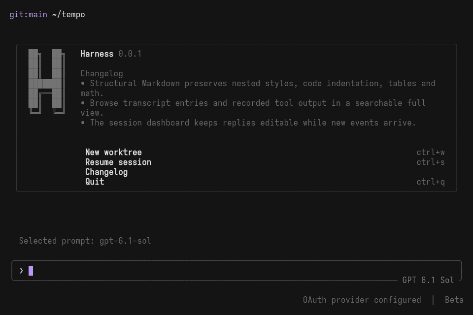

<div align="center">
  <h1>Harness</h1>
  <p>
    <strong>Koodausagentti päätteeseen.</strong><br />
    Päätät itse, mihin agentti saa koskea. Jokaisesta istunnosta jää jälki, jonka voit toistaa.
  </p>
  <p>
    <a href="https://github.com/urbanbreach/agent-harness/actions/workflows/ci.yml"></a>
    <a href="../LICENSE"></a>
    
    
  </p>
  <p>
    <a href="#asenna">Asenna</a> ·
    <a href="#aloita">Aloita</a> ·
    <a href="#yhdistä-palveluntarjoaja">Palveluntarjoajat</a> ·
    <a href="README.md">Dokumentaatio</a> ·
    <a href="../README.md">English</a>
  </p>
</div>

<p align="center">
  <picture>
    <source media="(prefers-reduced-motion: reduce)" srcset="assets/harness-tui.png" />
    
  </picture>
</p>

<p align="center">
  <sub>Käsikirjoittamaton istunto GPT 6.1 Sol -mallilla, tallennettu oikeasta päätekäyttöliittymästä. Minuutin mittaista tallennetta on nopeutettu ja pitkiä odotuksia leikattu.<br />
  <a href="assets/harness-tui.png">Still-kuva</a> · <a href="assets/README.md">Näin tallenne tehtiin</a></sub>
</p>

Harness on koodausagentti, jota käytät projektin sisällä. Anna sille tehtävä,
niin se lukee koodia, ajaa komentoja, muokkaa tiedostoja ja tarkistaa työnsä.
Jokainen työkalukutsu näkyy keskustelulokissa heti. Oikeussääntösi ratkaisevat,
mitä agentti saa tehdä kysymättä.

Harness on yksi Rust-binääri, jossa on Ratatui-käyttöliittymä. Yksi koordinaattori
hallinnoi kaikkia työkalukutsuja, oikeustarkistuksia ja ala-agentteja. Se kirjaa
tapahtumat lokiin, johon voi vain lisätä uusia tapahtumia. Lokin ansiosta voit
jatkaa istuntoja, haarauttaa niitä, palata aiempaan kohtaan ja toistaa niitä ilman
verkkoa. Toisto ei koskaan aja työkaluja uudelleen eikä ota yhteyttä palveluntarjoajaan.

## Mitä Harnessilla voi tehdä

| Ominaisuus | Tarkemmin |
| --- | --- |
| Tutut mallit | Kirjaudu ChatGPT-, GitHub Copilot- tai Claude-tilauksella tai aseta API-avain ympäristömuuttujaan. Tuettuja ovat OpenAI, Anthropic, Google, OpenRouter ja muut models.dev-palveluntarjoajat. Myös mikä tahansa OpenAI-yhteensopiva päätepiste toimii. |
| Työkalut käytännön työhön | Tiedostojen luku, kirjoitus ja muokkaus (mallin mukaan joko paikkauksilla, merkkijonojen korvauksilla tai hashline-ankkureilla), shell, grep, glob, verkkohaku ja verkkosisällön nouto, LSP, ast-grep, GitHub, MCP-palvelimet, JavaScript- ja Python-eval pysyvällä tilalla sekä taustalla toimiva `monitor`, joka herättää agentin, kun komento tai tiedosto muuttuu. |
| Ala-agentit | Agentti voi delegoida työtä agenteille `task`, `scout`, `reviewer`, `security-reviewer` ja `sonic` tai itse Markdownissa määrittelemillesi agenteille. Ala-agentteja koskevat samat projektin säännöt. |
| Oikeudet | Salli, kysy ja kiellä työkalun, polun tai shell-komennon kuvion perusteella. Halutessasi voit käyttää YOLO-tilaa tai ottaa käyttöön Landlock-rajoitukset shell-komennoille. |
| Toistettavat istunnot | Lokit, joihin voi vain lisätä tapahtumia, istuntojen jatkaminen, haarauttaminen ja kelaaminen, istuntopuu, toisto ilman verkkoa sekä tukipaketit, joista salaiset tiedot on peitetty. Voit myös tuoda istuntoja Codexista ja Claude Codesta. |
| Omat käytännöt | Lukee `AGENTS.md`-tiedoston (tai `CLAUDE.md`-tiedoston), lataa taitoja, ajaa elinkaarikoukkuja ja tekee Markdown-tiedostoista vinoviivakomentoja. |
| Päätekäyttöliittymä työn seuraamiseen | Keskusteluloki päivittyy vastauksen mukana ja näyttää muutokset. Lisäksi näet tehtäväpaneelin, tokenit sekunnissa, istunnon hinnan ja kontekstin käytön. Mukana ovat myös hallitut Git-työpuut ja komentovalikko. |

## Asenna

Harness toimii Linuxissa, x86_64- ja aarch64-arkkitehtuureilla. macOS:ää ja
Windowsia ei tueta.

```bash
curl -fsSL https://github.com/urbanbreach/agent-harness/releases/latest/download/install.sh | sh
```

Skripti lataa prosessorillesi sopivan staattisen binäärin, tarkistaa sen
julkaisun `SHA256SUMS`-tiedostoa vasten ja asentaa sen hakemistoon `~/.local/bin`.
Kolmansien osapuolten lisenssitiedot tulevat viereiseen `harness-licenses`-hakemistoon.
`HARNESS_VERSION=v0.1.0` valitsee tietyn julkaisun ja `HARNESS_INSTALL_DIR`
toisen asennushakemiston. Poista asennus poistamalla binääri ja lisenssihakemisto.

> [!NOTE]
> Yhtään julkaisua ei ole vielä merkitty tagilla. Käännä lähdekoodista, kunnes
> ensimmäinen julkaisu on saatavilla.

### Käännä lähdekoodista

Tarvitset Gitin ja vakaan Rust-työkaluketjun, jonka version
[`rust-toolchain.toml`](../rust-toolchain.toml) määrittää. Kääntäminen ei vaadi muuta.

```bash
git clone https://github.com/urbanbreach/agent-harness.git
cd agent-harness
cargo install --path crates/harness --locked
```

Käytä oikeissa istunnoissa release-koontia. Debug-koonti kuluttaa selvästi enemmän
suoritinaikaa, kun vastausta tulee mallilta. [Käännösasetusten ohje](testing/build-performance.md)
kertoo valinnaisesta Wild-linkkeristä.

### Valinnaiset työkalut

| Käyttö | Asenna |
| --- | --- |
| JavaScript-eval | [Node.js 24 tai uudempi](https://nodejs.org/en/download) `PATH`-polulle. Eval-skriptit tulevat Harnessin mukana, joten npm-asennusta ei tarvita. |
| Python-eval | `python3` tai `python` `PATH`-polulle |
| Rakenteellinen haku ja muokkaus | `ast-grep` `PATH`-polulle |
| Claude Pro/Max -tilaus | Asennettu Claude Code, johon olet kirjautunut |

## Aloita

```bash
cd /path/to/your/project
harness
```

Asetustiedostoa ei tarvita. Uudessa asennuksessa kirjautumisvalikko avautuu
itsestään. Valitse palveluntarjoaja, kirjaudu, kirjoita tehtävä ja paina Enter.
Esc sulkee valikon ja `/login` avaa sen uudelleen.

Haluatko ensin tutustua käyttöliittymään? `harness tui --mock` avaa saman
käyttöliittymän ilman verkkoa. Testipalveluntarjoaja vastaa jokaiseen kehotteeseen
`Hello world`.

## Yhdistä palveluntarjoaja

Päätekäyttöliittymän `/login` listaa kaikki Harnessin tuntemat palveluntarjoajat.
Listan alkupäässä ovat OpenAI, ChatGPT Plus/Pro, GitHub Copilot, Anthropic,
Claude Pro/Max ja Google. Samat kirjautumistavat toimivat komentoriviltä:

```bash
harness auth login codex     # ChatGPT Plus/Pro
harness auth list            # yhdistetyt palveluntarjoajat
harness doctor               # valmiustarkistus ilman verkkoa
```

Ympäristömuuttujan API-avain riittää ilman kirjautumista tai asetustiedostoa:

```bash
export ANTHROPIC_API_KEY="..."
harness
```

Harness löytää tallennetut tunnukset ja palveluntarjoajien API-avainten
ympäristömuuttujat sisäänrakennetun [models.dev](https://models.dev)-luettelon
avulla. `harness doctor` ei koskaan ota yhteyttä palveluntarjoajaan. Vasta
ensimmäinen oikea vuoro varmistaa, että tili ja päätepiste toimivat. Pidä avaimet
poissa asetustiedostoista. [Palveluntarjoajien opas](configuration/provider-support.md)
kuvaa kaikki yhteystavat.

## Käytä Harnessia

### Päätekäyttöliittymässä

| Näppäin | Toiminto |
| --- | --- |
| Enter | Lähetä kehote tai ohjaa käynnissä olevaa vuoroa |
| Alt+i | Lisää jatkokehote jonoon nykyisen vuoron jälkeen |
| Ctrl+Enter | Peruuta käynnissä oleva vuoro ja lähetä luonnos sen sijaan |
| `/` | Vinoviivakomennot: `/models`, `/sessions`, `/compact`, `/rewind`, `/worktree`, `/init` ja muita |
| `@` | Viittaa tiedostoon |
| Ctrl+p | Komentovalikko |
| Ctrl+x | Pikavalikko (teemat, mallit, tila, vienti) |
| Shift+Tab | Vaihda mallin päättelyvarianttia |
| Ctrl+o | Vaihda hyväksyntätilaa |
| Ctrl+t | Näytä tai piilota tehtäväpaneeli |
| Ctrl+c | Peruuta käynnissä oleva vuoro |

Voit määrittää näppäimet tiedostossa `tui.jsonc`.
[Suunnitteluohje](../DESIGN.md) listaa ne kaikki.

### Skripteistä

`harness run` ottaa kehotteen argumenteista, vakiosyötteestä tai tiedostosta.
Se odottaa vuoron loppuun ja tulostaa vain lopullisen vastauksen.

```bash
harness run "Summarize this workspace"
git diff | harness run "Review this change" --format json
harness run -c "Now add tests for it"        # jatka viimeisintä istuntoa
```

Valitsimilla voit määrittää mallin (`-m`), päättelyn tason, sallitut ja kielletyt
työkalut, oikeuksien esiasetukset ja liitteet. Katso
[kehotteiden komentoriviopas](operations/prompt.md).

### Muut komennot

| Komento | Toiminto |
| --- | --- |
| `harness sessions list` | Listaa projektin tallennetut istunnot |
| `harness sessions inspect <id>` | Näytä istunnon tapahtumat |
| `harness sessions tree` | Näytä istuntojen haarat |
| `harness replay --session <id>` | Toista istunto ilman palveluntarjoajia tai työkaluja |
| `harness export <id>` | Kirjoita näkyvä keskustelu Markdowniksi ja peitä salaiset tiedot |
| `harness dashboard status` | Näytä yhteenveto istunnoista ja paikallisista asetuksista |
| `harness config explain model` | Näytä asetuksen lähde |
| `harness models` | Listaa mallit, variantit ja tokenrajat |
| `harness completions <shell>` | Tulosta shell-täydennykset |

## Agentit, taidot ja komennot

Pääagentti delegoi työtä `spawn_subagent`-työkalulla. `task` perii pääagentin
mallin, `scout` ja `sonic` käyttävät roolia `@smol` ja molemmat arvioijat roolia
`@slow`. Valitse rooleille mallit asetuksella `model_roles`. Jos roolia ei ole
määritetty, ala-agentti perii pääagentin mallin. Omat agentit ovat
Markdown-tiedostoja YAML-alkutietoineen hakemistossa `.harness/agents/`
(projektin agentit) tai `~/.harness/agents/` (omat agentit). Projektin määritys
voittaa oman määrityksen, joka puolestaan voittaa valmiin agentin. Lue lisää
[agenteista ja tehtävistä](operations/generic-agent-and-tasks.md).

Taidot latautuvat projektin hakemistoista `.harness/skills` ja `.agents/skills`
sekä samoista kahdesta hakemistosta kotihakemistossa. Markdown-tiedostot
hakemistoissa `.harness/commands/` ja `~/.harness/commands/` muuttuvat
vinoviivakomennoiksi. Harness täyttää niihin arvot `$ARGUMENTS` ja `$1`...`$9`.
Komennot toimivat myös ilman käyttöliittymää: `harness run "/name args"`.
Valmis `/init` kirjoittaa tai päivittää lyhyen `AGENTS.md`-tiedoston projektin
juureen ja säilyttää itse kirjoittamasi sisällön. [Laajennusopas](operations/extension-strategy.md)
kertoo taidoista, MCP-palvelimista ja [koukuista](operations/hooks.md).

## Määritä oikeudet

Oletuksena tavalliset työkalut toimivat kysymättä. Harness kysyy luvan ennen
kuin se koskee projektin ulkopuolisiin polkuihin, toistaa saman kutsun tai lukee
`.env`-tiedostoja. Voit tiukentaa sääntöjä omassa tai projektin asetustiedostossa:

```jsonc
"permission": {
  "*": "allow",
  "edit": "ask",
  "bash": {
    "*": "deny",
    "git status*": "allow",
    "cargo nextest run*": "ask"
  },
  "webfetch": "deny"
}
```

Viimeinen täsmäävä sääntö ratkaisee. Kirjoita yleiset säännöt ensin ja poikkeukset
niiden jälkeen. Säilytä alun `"*": "allow"`. Kun `permission`-lohko on olemassa,
kaikki työkalut, joilla ei ole omaa sääntöä (`todowrite`, `skill`, istuntotyökalut),
kysyvät luvan joka kerta.

`--yolo` (tai `/yolo`) hyväksyy istunnon tavalliset lupapyynnöt.
`--sandbox readonly` taas on nopea vain luku -esiasetus komennolle `harness run`.

Oikeudet ratkaisevat, mitkä työkalukutsut saa ajaa. Ne eivät ole käyttöjärjestelmän
hiekkalaatikko: hyväksytty shell-komento voi tehdä kaiken, minkä käyttäjäsikin voi.
Jos haluat rajata shell-komentojen pääsyä tiedostojärjestelmään, aseta
`HARNESS_OS_SANDBOX_POLICY` arvoon `workspace_write`, `read_only` tai `strict`
(Linux Landlock). Lue [oikeusopas](permissions/permissions.md) ennen kuin jaat
säännöt tiimille tai ala-agenteille.

## Asetukset

Asetustiedosto on valinnainen. Ensimmäisen onnistuneen kirjautumisen jälkeen
Harness kirjoittaa tiedostoon `~/.harness/harness.jsonc` kyseisen palveluntarjoajan
oletusmallin. Se ei kirjoita tiedostoa, jos oma asetustiedosto on jo olemassa tai
`HARNESS_CONFIG` tai `HARNESS_CONFIG_CONTENT` on asetettu. Tallenna omat oletuksesi
sinne ja projektin säännöt projektin juuren tiedostoon `harness.jsonc` tai
`.harness/harness.jsonc`. Projektin asetukset ohittavat omat asetuksesi.
Näppäinasetukset kuuluvat tiedostoon `tui.jsonc`.

```bash
harness config sources             # kaikki etsityt tiedostot latausjärjestyksessä
harness config show --effective    # yhdistetyt asetukset, salaiset arvot peitettyinä
harness schema                     # JSON-skeema editorin täydennyksiä varten
```

[`configs/harness.example.jsonc`](../configs/harness.example.jsonc) on lyhyt,
kommentoitu lähtökohta. Yksikin `provider`-määritys vaihtaa malliluettelon
automaattisesta hausta rajattuun luetteloon. Siihen jäävät vain määritetyt
palveluntarjoajat sekä kirjautuneet Codex-, GitHub Copilot- ja Claude-tilaustilit.
[Asetusviite](configuration/config.md) listaa kaikki avaimet.

## Missä data on

Kaikki Harnessin tallentamat käyttäjän tiedot tulevat hakemistoon `~/.harness/`.
Jos `$HARNESS_HOME` on asetettu eikä se ole tyhjä, Harness käyttää sen arvoa
sellaisenaan:

| Polku | Sisältö |
| --- | --- |
| `harness.jsonc`, `tui.jsonc` | Omat ajonaikaiset asetukset ja näppäinasetukset (myös `.json` käy) |
| `credentials/`, `anthropic-subscription-bindings/` | Kirjautumistiedot ja tilaustilien sidokset |
| `models-cache.json`, `model.json` | Mallien metatietojen välimuisti ja viimeksi TUI:ssa valittu malli |
| `prompts/`, `agents/`, `commands/`, `skills/` | Omat kehotepohjat, agentit, vinoviivakomennot ja taidot |
| `sessions/<key>/` | Istuntolokit ja istuntojen tiedostot |
| `projects/<key>/` | Työtilan muisti, koodi-indeksi, muokkausten jäljitys ja suunnitelmat |
| `worktrees/<key>/` | Hallitut Git-työpuut |

`<key>` koostuu etuliitteestä `v2-` ja projektin kanonisesta polusta lasketusta
BLAKE3-tiivisteestä. Näin jokainen projekti saa oman, vakiopituisen hakemistonsa.
Projektin `.harness/` sisältää itse kirjoittamasi agentit, komennot, taidot ja
kehotepohjat, projektin asetukset sekä muistetut käyttöluvat. Vanhat
`--path--`-hakemistot säilyvät ennallaan. Katso
[vanhan tallennusrakenteen ohje](architecture/sessions-and-replay.md#legacy-storage),
jos haluat siirtää ne. Varhaisten versioiden istunnot hakemistossa
`<project>/.agent-harness/sessions` aukeavat komennolla
`harness sessions list --session-dir .agent-harness/sessions`.

Ennen kuin jaat istunnon, aja `harness sessions export <id> --output bundle.json`.
Paketti säilyttää toistoon tarvittavat metatiedot mutta jättää pois
palveluntarjoajan delta-tapahtumat ja työkalujen tietosisällöt. Jos tarkistus
löytää salaisuuksia, vienti ei kirjoita mitään. [Yksityisyys ja paikallinen
data](permissions/privacy-and-local-data.md) kertoo, mitä tietoja koneeltasi
lähtee ja milloin.

## Dokumentaatio

| Käytä Harnessia | Kehitä Harnessia |
| --- | --- |
| [Asetukset](configuration/config.md) | [Arkkitehtuuri](architecture/architecture.md) |
| [Palveluntarjoajat](configuration/provider-support.md) | [Päätekäyttöliittymän suunnittelu](../DESIGN.md) |
| [Sisäänrakennetut työkalut](tools/native-tool-catalog.md) | [Testaus](testing/testing.md) |
| [Oikeudet](permissions/permissions.md) | [Julkaiseminen](operations/releasing.md) |
| [Istunnot ja toisto](architecture/sessions-and-replay.md) | [Muutosloki](../CHANGELOG.md) |
| [Vianmääritys](operations/troubleshooting.md) | [Koko dokumentaatio](README.md) |

## Kehitä

Työtila koostuu seitsemästä Rust 2024 -cratesta ja käyttää vakaata työkaluketjua.
Aloita [arkkitehtuuriohjeesta](architecture/architecture.md), joka kuvaa vastuut.
Lue [päätekäyttöliittymän suunnitteluohje](../DESIGN.md) ennen käyttöliittymän
muokkaamista.

```bash
cargo fmt --all -- --check
scripts/test-lanes.sh fast
scripts/test-lanes.sh quality-gates
```

Testit ajetaan nextestillä. [Testausohje](testing/testing.md) kuvaa integraatio-,
simulaatio-, suorituskyky- ja PTY-testit sekä oikeita palveluntarjoajia käyttävät
testiryhmät.

## Lisenssi

[MIT](../LICENSE)
